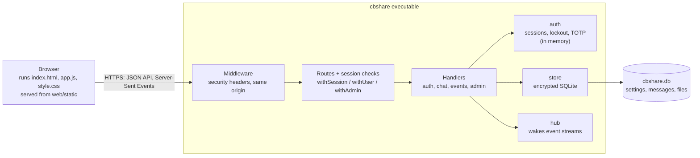
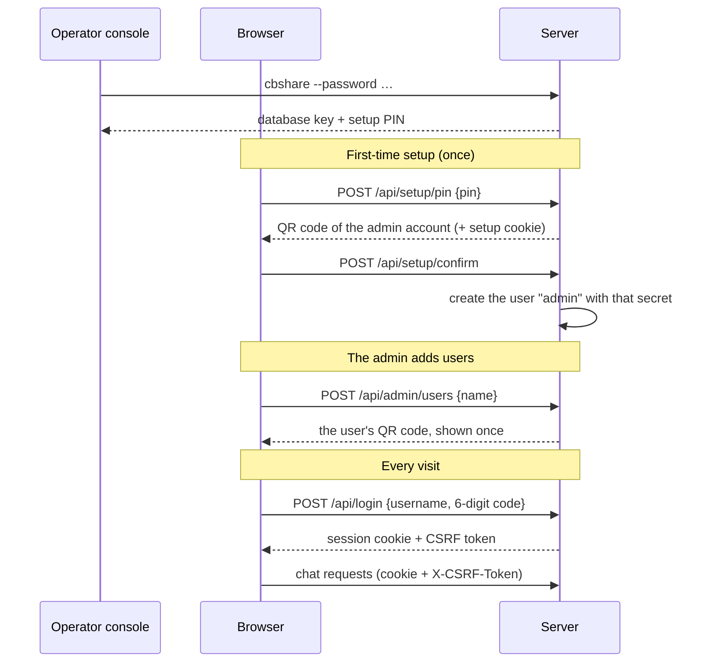

# cbshare

Share text snippets and small files between the machines on your local network. One machine runs `cbshare`; everyone else opens it in a browser and sees the same group chat. Paste a command, a config file or a password on one computer, copy it on another.

- **One executable** for Windows and Linux, no installation, no internet access needed.
- **Encrypted everywhere**: HTTPS on the wire, an encrypted SQLite database on disk.
- **Personal authenticator codes**: the admin adds each person (up to 10 by default) and gives them their own QR code; they sign in with their username and a 6-digit code from their authenticator app. Access can be revoked per person.
- **Group chat**: text kept exactly as typed with a copy button, file attachments up to 20 MB, edit and delete your own messages, live updates.
- **Small footprint**: only the latest 20 messages are kept; older ones and their files are deleted.

Full documentation: [docs/](docs/index.md), published at https://pycloux.github.io/cbshare/ when GitHub Pages is enabled.

## Quick start

Download the archive for your platform from the [releases](https://github.com/pycloux/cbshare/releases) page, extract it, and start the server with an admin password:

```sh
cbshare --password "choose-an-admin-password"
```

The console prints three things:

1. **The database key.** Keep it safe: you need it to restart the server, and without it the data cannot be recovered.
2. **The address** to open, such as `https://192.168.1.10:8443/`.
3. **A setup PIN.**

Open the address in a browser. It warns about the certificate the first time, because cbshare uses a self-signed one; accept it (compare the fingerprint printed in the console if you want to be sure). Then:

1. Enter the setup PIN. The QR code of the **admin** account appears: it is yours, don't share it.
2. Scan it with an authenticator app (Google Authenticator, Microsoft Authenticator, 2FAS, Aegis, …) and choose **I've added it, continue**.
3. Sign in as `admin` with the 6-digit code from your app.
4. Choose **Admin**, enter the admin password, then **Admin tools → Manage users**, and add each person. Send each one their QR code privately; it must be used within 24 hours.

To restart the server later, use the key instead of the password:

```sh
cbshare --key ABCDE-FGHIJ-...
```

Everyone's authenticator entry keeps working after a restart.


## Using it

- **Send**: type or paste, then press **Send** or **Ctrl+Enter**. Enter alone adds a new line.
- **Share a file**: press **+** or drop the file onto the page. Text in the message box becomes the file's caption.
- **Copy**: every message has a **Copy** button that copies the text exactly.
- **Edit or delete**: available on your own messages.
- **Sign out**: closing the browser also signs you out; sessions end after 30 minutes without activity.

Failed sign-in attempts are announced in the chat with the source IP address, and an address is locked out for 5 minutes after 5 failures.

### Admin

Sign in as `admin`, choose **Admin** and enter the admin password from the first start to:

- edit or delete any message, including system messages;
- **manage users**: add a user (their QR code is shown once), give a user a new QR code, revoke their access, or delete them (their messages stay, marked as from a deleted user);
- **replace your own QR code**: only your sessions end; other users are not affected.

## Configuration

Every setting has a default and can be changed with a flag or a YAML file (`--config cbshare.yaml`, see [cbshare.example.yaml](cbshare.example.yaml)). Flags override the file.

| Flag | YAML key | Default | Meaning |
| --- | --- | --- | --- |
| `--password` | | | Admin password; first start only, creates the database |
| `--key` | | | Database key printed at first start; used to restart |
| `--config` | | | YAML configuration file |
| `--port` | `port` | `8443` | HTTPS port |
| `--bind` | `bind` | primary LAN IP | Address to listen on; `0.0.0.0` for all interfaces |
| `--db` | `database` | `cbshare.db` | Encrypted database file |
| `--tls-cert`, `--tls-key` | `tls_cert`, `tls_key` | self-signed | Your own certificate and key (PEM) |
| `--max-messages` | `max_messages` | `20` | Messages kept, system messages included |
| `--max-file-size` | `max_file_size_mb` | `20` | Maximum file size in MB |
| `--max-users` | `max_users` | `10` | User accounts, the admin included (1 to 100) |
| `--mode` | `mode` | `sse` | `sse` for live updates, `polling` if your network blocks them |
| `--poll-interval` | `poll_interval` | `3s` | Refresh interval in polling mode |
| `--max-attempts` | `max_failed_attempts` | `5` | Failed attempts before an IP is locked out |
| `--lockout` | `lockout_duration` | `5m` | Lockout duration |
| `--session-timeout` | `session_timeout` | `30m` | Sign-out after inactivity |
| `--pin-length` | `pin_length` | `6` | Length of the setup PIN |

`CBSHARE_PASSWORD` and `CBSHARE_KEY` can be used instead of `--password` and `--key` to keep them out of your shell history and process list.

## Security model

- All traffic uses TLS 1.2 or later. The self-signed certificate is stored in the database, so it stays the same across restarts.
- The database key is derived from the admin password, a random salt and the start time with Argon2id. Every page of the database is encrypted with it (Adiantum), so the file cannot be opened with a SQLite client.
- The admin password is stored only as an Argon2id hash.
- Every user has their own authenticator secret, so a code proves who someone is; messages belong to the account that posted them. Each code is accepted once, and unknown names and wrong codes get the same answer. Revoking, replacing or deleting an account takes effect at once.
- Sessions live only in the server's memory and in a browser-session cookie (`Secure`, `HttpOnly`, `SameSite=Strict`).
- State-changing requests need a per-session anti-CSRF token and must come from the cbshare page itself. A strict Content Security Policy blocks inline and third-party scripts.
- Shared files are always served as downloads, never displayed in the page.

If the key is lost, the database cannot be decrypted: delete the file and start again with `--password`.

## Building from source

Requires Go 1.26.0 or later.

```sh
make build        # ./cbshare
make test         # Go tests: unit, integration and end-to-end
make e2e          # external tests: the P1 cases of the test plan (see tests/e2e)
make cross        # Linux and Windows binaries in dist/
```

Pushing a tag such as `v1.0.0` starts the release workflow. It runs the Go tests on Linux and Windows and the full external test suite (every automated case of the test plan in Chromium, Firefox and WebKit), then builds the archives and publishes them on GitHub. If any test fails, nothing is published: fix it, delete the tag, and push it again.

Before announcing a release, run the [manual test plan](https://claude.ai/artifact/M6TvUvY8gc9KUiQKvpg6CW) on the published archives. It holds the 8 cases a machine can't check, such as real phones, a Windows server and arm64 hardware.

## How the application is built

This section is for developers: where each feature lives, and how a request travels through the code.

### Overview

cbshare is one Go program. It serves a small single-page web application (plain HTML, CSS and JavaScript, embedded in the executable) and a JSON API, over HTTPS. Everything persistent is in one encrypted SQLite file; everything about who is signed in is kept in memory.



### Repository layout

```text
cmd/cbshare/          entry point: startup sequence, console output
  main.go              parse config, open or create the database, load TLS, serve
  main_test.go         end-to-end test of the built binary
internal/
  config/            settings: defaults < YAML file < flags; LAN IP detection
  crypto/            key derivation and display format, password hashing, PINs, tokens
  store/             encrypted SQLite database: settings, users, messages, files, retention
  tlsutil/           self-signed certificate (kept in the database) or your own
  auth/              building blocks without HTTP: lockout, sessions, TOTP secrets, replay guard
  server/            HTTPS server and JSON API
    server.go          Server type, routes, startup and shutdown, JSON helpers
    security.go        security headers, same-origin and anti-CSRF checks
    auth.go            setup (PIN, admin QR code), sign-in, session middleware
    users.go           user management by the admin: create, new QR code, revoke, delete
    chat.go            messages and files
    events.go          live updates (Server-Sent Events)
    admin.go           admin unlock, moderation, the admin's own QR code
web/
  embed.go           embeds static/ into the executable
  static/            the front end: index.html (all screens), app.js, style.css
docs/                user documentation (MkDocs site)
.github/workflows/   CI (tests, builds), release, documentation site
```

Dependencies only go "downwards": `server` uses `auth`, `store`, `crypto`, `config` and `web`; `auth` uses `crypto` for random tokens; `config`, `crypto`, `store` and `tlsutil` depend on no other cbshare package. Only `server` knows about HTTP. `cmd/cbshare` assembles everything (and passes the store to `tlsutil` to keep the certificate).

### Startup sequence

`run()` in [cmd/cbshare/main.go](cmd/cbshare/main.go):

1. **Configuration.** `config.Parse` starts from `config.Default()`, applies the YAML file given with `--config`, then only the flags actually typed. The bind address is auto-detected if not set.
2. **Database.**
   - First start (`--password`): `crypto.DeriveKey` derives a 256-bit key from the password, a random salt and the time, `store.Create` creates the encrypted file, and an Argon2id hash of the password is saved for the admin unlock. The key is printed once.
   - Restart (`--key`): `crypto.DecodeKey` checks the key's checksum, and `store.Open` decrypts the database (a wrong key is detected immediately).
3. **TLS.** `tlsutil.Load` uses your certificate, or reuses the self-signed one stored in the database, or creates and stores a new one.
4. **Server.** `server.New` looks for the admin account in the database. If there is none, setup has never been done, and it generates the setup PIN that `main` prints.
5. **Serve** until Ctrl+C or SIGTERM, then shut down gracefully (open event streams are closed first).

### How a request is handled

```text
securityHeaders      adds CSP, nosniff, frame and referrer policies to every response
 └ sameOrigin        rejects state-changing requests coming from another site
    └ ServeMux       routes "METHOD /path" to a handler
       └ withUser      finds the session from its cookie (every session belongs to a user)
                        and checks the anti-CSRF token, or
          withAdmin     also requires the admin account with admin rights unlocked
          └ handler    validates input, calls store / auth, writes JSON
             └ changed()  after a write: bumps the chat revision, wakes event streams
```

Handlers read the session with `sessionFrom(r)`. Errors are always JSON: `{"error": "sentence to show", "code": "stable_identifier"}`. The front end displays `error` and reacts to `code` (for example `unauthenticated` returns to the sign-in screen).

### Authentication



- **One secret per user** ([internal/auth/totp.go](internal/auth/totp.go), [internal/server/users.go](internal/server/users.go)): a valid code proves who someone is, and the account name is shown next to their messages. `handleLogin` checks the code against the named user's secret only; an unknown name is checked against a dummy secret, so every failure looks the same. A `ReplayGuard` refuses a code of a time step the user already signed in with. A new QR code waits 24 hours for its first sign-in (`enrolmentWindow`), then expires (`expireEnrolments`, also run by the janitor).
- **Sessions** ([internal/auth/sessions.go](internal/auth/sessions.go)) live only in memory. Each has a random token (in an HttpOnly cookie), a CSRF token, the user's id and name, whether it is the admin account, an admin-rights flag, and a `Done` channel closed when it ends. `EndUser` ends all of one user's sessions when their access changes. Requests marked `touch` reset the 30-minute inactivity timer; background requests (polling, event stream) don't.
- **Lockout** ([internal/auth/limiter.go](internal/auth/limiter.go)) counts failures per IP for the PIN, the code and the admin password. Each check first reserves an attempt (`beginAttempt` in [server/auth.go](internal/server/auth.go)), which counts against the limit until it is settled as a failure (`authFailed`, which also posts a system message with the IP), a success, or cancelled; so parallel requests cannot get more guesses checked than allowed. Admin password checks (Argon2id) also wait for one of two slots (`acquireHashSlot` in [server/admin.go](internal/server/admin.go)), which bounds CPU and memory use.
- **Admin** ([internal/server/admin.go](internal/server/admin.go)) is a flag on a session of the admin account, set after checking the password hash; other accounts are refused before the password is checked. **Rotation** replaces the admin's own secret in two steps (show, then confirm) and ends only the admin's sessions.

### Data model

All in the encrypted database ([internal/store](internal/store)):

| Table | Content |
| --- | --- |
| `settings` | key/value: `admin_password_hash`, `tls_cert_pem`, `tls_key_pem` |
| `users` | `id`, `name`, `name_key` (lower case, unique), `is_admin` (one row at most), `status` (`pending`, `active`, `revoked`, `expired`), `totp_secret` (erased once revoked or expired), `enrol_expires_at`, `created_at`, `activated_at`, `last_login_at` |
| `messages` | `id`, `kind` (`text`, `file` or `system`), `user_id` (NULL for system messages and deleted users), `author`, `body`, `created_at`, `edited_at` |
| `files` | `message_id`, `name`, `mime`, `size`, `data` — deleted with their message |

**Retention:** every insert runs in a transaction that also deletes all but the newest `max_messages` messages; their files go with them through `ON DELETE CASCADE`.

**Ownership:** a message belongs to its `user_id`, not its name, since a deleted user's name can be reused. `loadOwnMessage` in [server/chat.go](internal/server/chat.go) allows edit and delete for that user or the admin; system messages can only be deleted, by the admin. Deleting a user sets `user_id` to NULL (`ON DELETE SET NULL`): the message stays, marked `authorDeleted`.

**Schema version:** `PRAGMA user_version` is 2. Databases in the old shared-code format (version 1, written only by cpsync v0.2, the project cbshare grew out of) are refused with `store.ErrOldSchema`; there is no migration.

### Live updates

The server keeps a **revision** number that `changed()` increments after every write. Browsers never receive message data through live updates, only the revision; when it differs from theirs, they fetch the whole list with `GET /api/messages`. So there is one way of loading messages, shared by both modes:

- **SSE mode** (default): `GET /api/events` keeps a stream open. The `hub` in [server/events.go](internal/server/events.go) wakes each stream on change; the stream sends `event: rev`. When the session ends, it sends `event: logout`.
- **Polling mode** (`--mode polling`): the browser calls `GET /api/messages?since=<rev>` every few seconds and gets `{"unchanged": true}` when nothing changed.

### Front end

[web/static/app.js](web/static/app.js) is organised in sections (API, screens, setup and sign-in, chat, live updates, rendering, composer, admin). The key ideas:

- **[index.html](web/static/index.html) holds every screen**; `show()` displays one. `route()` asks `GET /api/state` which one to show, so the server is always the source of truth.
- **`api()`** wraps `fetch`: it sends the CSRF token, parses JSON, throws `ApiError`, and returns to the sign-in screen on a 401.
- **`render()`** updates the message list in place, rebuilding only messages whose version changed and leaving a message being edited alone. Text is always inserted with `textContent`, never as HTML.
- **[style.css](web/static/style.css)** defines colour tokens as CSS variables, with dark-mode overrides. The eight `--cable-N` colours identify authors.

The Content Security Policy forbids inline scripts and styles, so all behaviour lives in `app.js` and all styling in `style.css`.

### HTTP API

All endpoints return JSON. "Session" means a valid session cookie; state-changing requests with a session also need the `X-CSRF-Token` header, and JSON bodies need `Content-Type: application/json`.

| Method and path | Access | Purpose |
| --- | --- | --- |
| `GET /api/health` | anyone | Liveness check and version |
| `GET /api/state` | anyone | Which screen to show, limits, mode, your session's CSRF token |
| `POST /api/setup/pin` | anyone, before setup | `{pin}` → QR code and secret of the admin account |
| `POST /api/setup/confirm` | the browser that entered the PIN | Create the admin account, end setup |
| `POST /api/login` | anyone, after setup | `{username, code}` → session cookie and `csrf`; one `invalid` error for every failure |
| `POST /api/logout` | anyone | End the session |
| `GET /api/messages[?since=rev]` | session | Message list and revision, or `{unchanged: true}` |
| `POST /api/messages` | session | `{text}` → new message |
| `PUT /api/messages/{id}` | author or admin | `{text}` → edited message |
| `DELETE /api/messages/{id}` | author or admin | Delete a message and its file |
| `POST /api/files` | session | Multipart `file` and optional `caption` → new message |
| `GET /api/files/{id}` | session | Download a file |
| `GET /api/events` | session | Server-Sent Events: `rev`, `logout` (SSE mode only) |
| `POST /api/admin/login` | admin account | `{password}` → admin rights for this session (`admin_only` for other users) |
| `POST /api/admin/logout` | session | Drop admin rights |
| `POST /api/admin/rotate` | admin | Show a new QR code for the admin account (not active yet) |
| `POST /api/admin/rotate/confirm` | admin | Switch to it; only the admin's sessions end |
| `POST /api/admin/rotate/cancel` | admin | Keep the current code |
| `GET /api/admin/users` | admin | Users with status, dates and open sessions; `count` and `max` |
| `POST /api/admin/users` | admin | `{name}` → the user and their QR code (shown once); `invalid_username`, `name_taken`, `user_limit` |
| `POST /api/admin/users/{id}/qr` | admin | New QR code for a user: the old one stops working, their sessions end |
| `POST /api/admin/users/{id}/revoke` | admin | Revoke a user's access; their sessions end |
| `DELETE /api/admin/users/{id}` | admin | Delete a user; their messages stay |

### Tests

| Where | What |
| --- | --- |
| `internal/*/..._test.go` | Unit tests of each package (key format, lockout rules, retention, certificates, …) |
| `internal/server/*_test.go` | API tests against a real server with real cookies; helpers in [harness_test.go](internal/server/harness_test.go) |
| `cmd/cbshare/main_test.go` | Builds the binary and runs first start, setup, sign-in, restart with the key |
| [`tests/e2e`](tests/e2e) | External tests in Python (pytest + Playwright): the test plan's cases against the built program and real browsers, named by case ID |

Run the Go tests with `make test` (race detector included) or `go test ./...`; CI runs them on Linux and Windows. The external tests are described in [tests/e2e/README.md](tests/e2e/README.md); CI runs their P1 cases on every pull request, and every release runs them all. The few cases that need a person (real phones, Windows, arm64) are in the manual test plan linked under [Building from source](#building-from-source).

### Common changes

- **New setting:** follow the checklist at the top of [internal/config/config.go](internal/config/config.go).
- **New endpoint:** add the handler to the matching file in `internal/server`, register it in `routes()` in [server.go](internal/server/server.go) with the right access wrapper, call `s.changed()` if it modifies the chat, and add a test.
- **New screen or button:** add the markup to `index.html`, the behaviour to the matching section of `app.js`, and styles to `style.css` using the existing tokens.

## License

cbshare is free software: you can redistribute it and/or modify it under the terms of the GNU General Public License as published by the Free Software Foundation, version 3. See [LICENSE](LICENSE).
