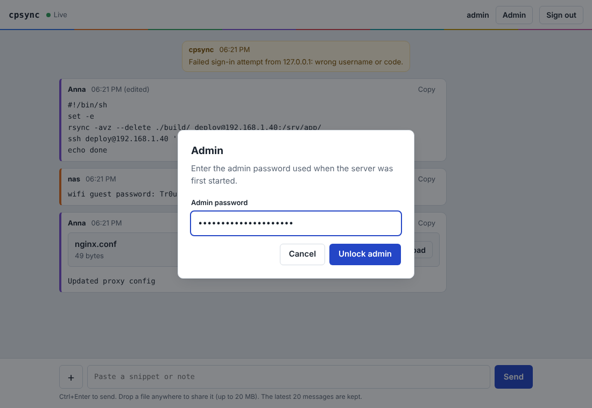
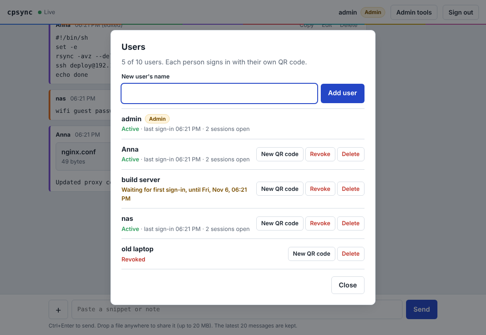
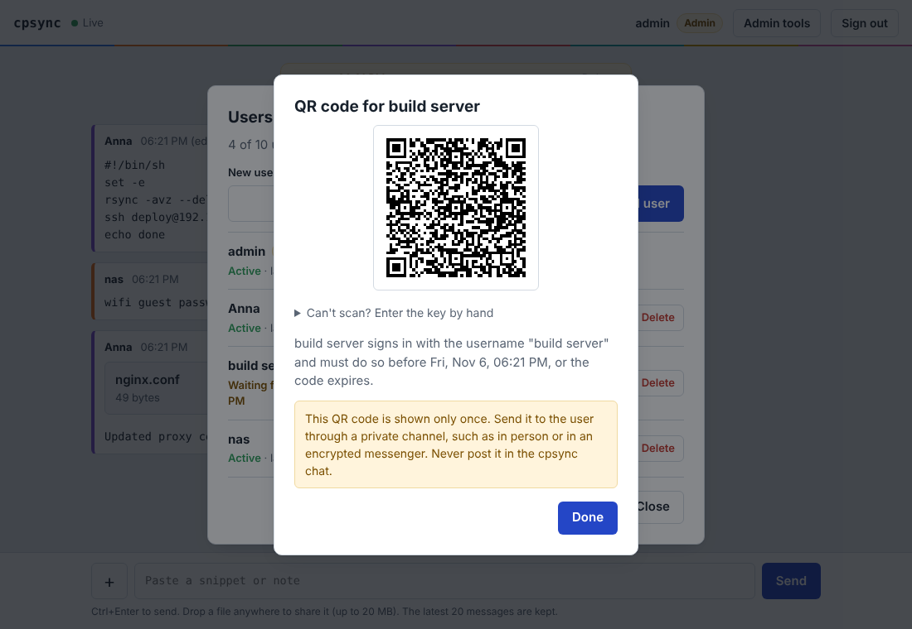
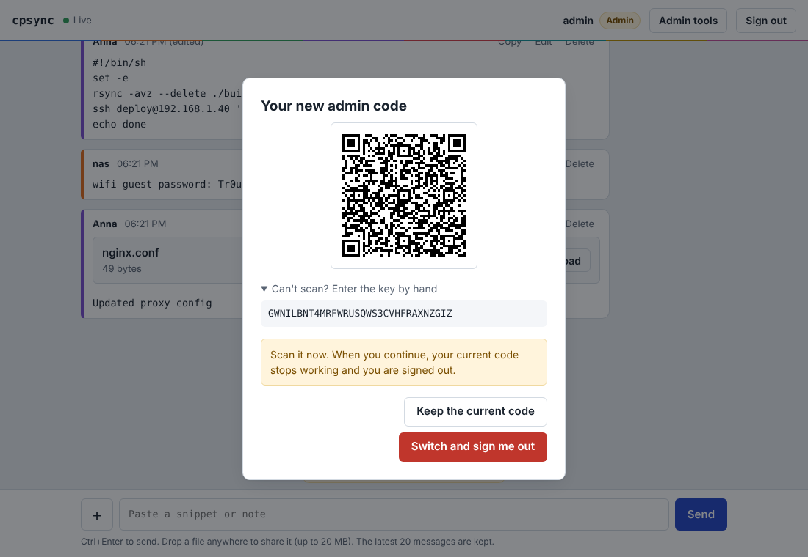

# Administration

The admin is the `admin` account created at [first start](first-start.md). Admin rights are unlocked per browser session, on top of signing in as `admin`, with the admin password chosen at first start. Other users don't see the **Admin** button, and the server refuses to check the password for them.

## Unlocking admin

1. Sign in as `admin`.
2. Choose **Admin** in the top bar.
3. Enter the admin password and choose **Unlock admin**.

{ width="640" }

An **Admin** badge appears next to your name. Wrong passwords count as failed sign-in attempts: they are announced in the chat and lead to a lockout after 5 tries.

Admin rights end when you choose **Admin tools → Lock admin**, sign out, or your session ends.

## Managing users

Each person who uses cpsync has their own account and QR code. Open **Admin tools → Manage users** to see them all, with their status, last sign-in and open sessions.

{ width="640" }

cpsync allows 10 accounts by default, the admin included; change it with [`max_users`](configuration.md#users). Usernames are up to 32 characters, unique whatever their letter case (`Anna` and `anna` are the same name), and `admin` and `cpsync` are reserved. A username cannot be changed: to rename someone, delete the account and add a new one.

### Add a user

1. Type the person's name under **New user's name** and choose **Add user**.
2. Their QR code appears, with the deadline for their first sign-in.
3. Send the QR code to the person **through a private channel**: show it to them in person, or send a screenshot through an encrypted messenger. Never post it in the cpsync chat, where everyone would see it.
4. Choose **Done**.

{ width="640" }

!!! warning "The QR code is shown only once"
    When you close the dialog, the code is gone: cpsync never shows it again. If it was lost, give the user a new QR code.

The person adds the code to their authenticator app, then signs in with their username and the current code. Until then, the list shows them as *Waiting for first sign-in*. If they don't sign in within **24 hours**, the code expires (*QR code expired*): give them a new one.

### Give a user a new QR code

Use **New QR code** when someone lost their phone, deleted the entry from their app, or let their code expire. The old code stops working at once, the user is signed out, and the new code must be used within 24 hours, like a new user's.

### Revoke access

**Revoke** stops a user from signing in, for example when someone leaves or a code may have been seen by someone else. They are signed out immediately, everywhere, and their code is erased. Their messages stay. To let them back in, give them a new QR code.

### Delete a user

**Delete** removes the account. The user is signed out immediately. Their messages stay in the chat, marked "(deleted user)", and you can still delete them as admin. The name becomes free again: a new account with that name does not get the old messages.

The admin account cannot be revoked or deleted, so admin access is never lost.

Every change is announced in the chat ("The admin added Anna.") and logged on the server console. QR codes and secrets are never logged.

## Moderating messages

While admin is unlocked, every message shows **Edit** and **Delete**, whoever sent it. System messages can be deleted, but not edited.

Use this to remove a password that was posted by mistake, or to clean up failed sign-in alerts once you've checked them.

## Replace your own QR code

Replace the admin account's code if your phone was lost or the code may have been seen. Other users are not affected.

1. Choose **Admin tools**, then **Replace my QR code**.
2. A new QR code appears. Nothing has changed yet: your current code still works.
3. Scan the new code into your authenticator app.
4. Choose **Switch and sign me out**.

{ width="640" }

From that moment the old code no longer works and your sessions end, on every machine. Sign in again as `admin` with the new code. The chat shows a system message explaining what happened.

If you change your mind, choose **Keep the current code** or close the dialog: the new code is discarded.

## Running cpsync as a service

=== "Linux (systemd)"

    Create `/etc/cpsync/env` with the key, readable only by root:

    ```sh
    CPSYNC_KEY=GTR74-AKCYX-...
    ```

    Then `/etc/systemd/system/cpsync.service`:

    ```ini
    [Unit]
    Description=cpsync
    After=network-online.target
    Wants=network-online.target

    [Service]
    EnvironmentFile=/etc/cpsync/env
    ExecStart=/usr/local/bin/cpsync --db /var/lib/cpsync/cpsync.db --config /etc/cpsync/cpsync.yaml
    DynamicUser=yes
    StateDirectory=cpsync
    Restart=on-failure

    [Install]
    WantedBy=multi-user.target
    ```

    Start it with `sudo systemctl enable --now cpsync`, and read its output with `journalctl -u cpsync -f`.

    Do the first start (with `--password`) by hand, then move the database to `/var/lib/cpsync/`.

=== "Windows"

    The simplest option is a scheduled task that runs at startup:

    1. Open **Task Scheduler** and choose **Create Task**.
    2. On **Triggers**, add **At startup**.
    3. On **Actions**, start `C:\Tools\cpsync\cpsync.exe` with the arguments `--db C:\Tools\cpsync\cpsync.db` and start in `C:\Tools\cpsync`.
    4. Set the `CPSYNC_KEY` environment variable for the account that runs the task, rather than putting the key in the arguments.

## Logs

cpsync writes its log to the console: sign-ins (with the username), failed attempts, admin actions, user changes (added, new QR code, revoked, deleted, expired), messages posted (by number and size), file names shared, and session expiries. Message texts and file contents are never logged. There is no log file; redirect the output if you want to keep it.
