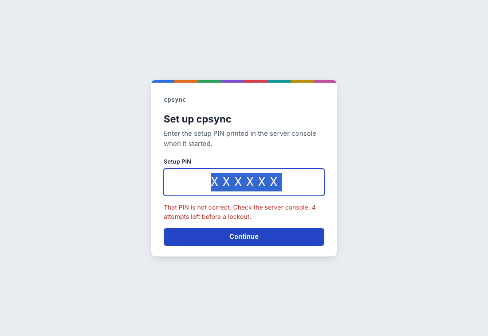
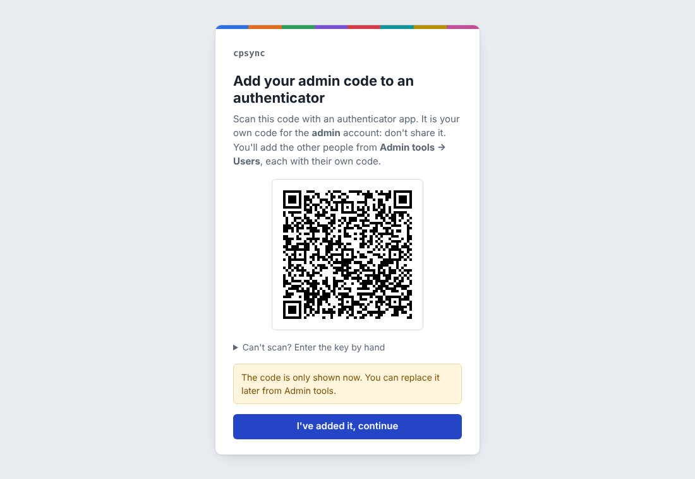
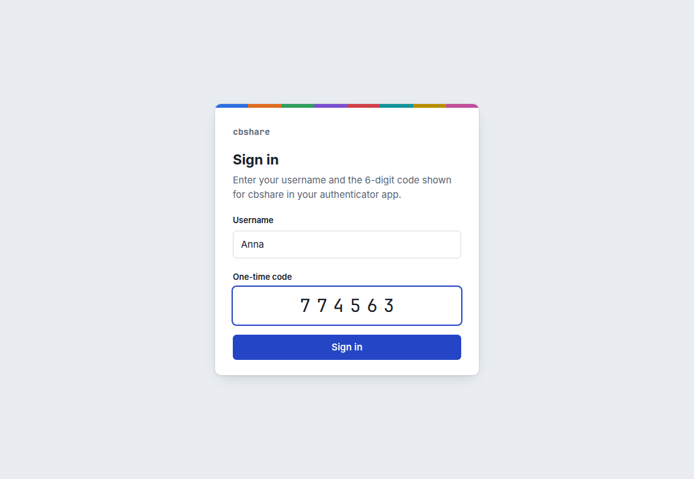

# First-time setup

Setting up cbshare takes two minutes: start the server with an admin password, then add the admin account's QR code to your authenticator app. After that, you add the other people from the admin tools, each with their own QR code.

## 1. Start the server

Choose an admin password and start cbshare with it:

```sh
cbshare --password "choose-an-admin-password"
```

!!! tip "Keep secrets out of your shell history"
    You can set the password in the `CBSHARE_PASSWORD` environment variable instead of passing `--password`.

The console shows:

```text
================================================================================
 Database cbshare.db created.

 DATABASE KEY - keep it safe, it is needed to restart the server.
 If it is lost, the database cannot be recovered.

   GTR74-AKCYX-APMTM-LEY3F-PN2OG-554MX-W3SMB-GSY6T-QHHIB-TRQ5G-XB5QQ

 Restart with:  cbshare --key GTR74-AKCYX-...
================================================================================

Certificate SHA-256 fingerprint:
  66:0F:D1:7C:AB:5D:...

Open https://192.168.1.10:8443/ in a browser on your LAN. Press Ctrl+C to stop.

--------------------------------------------------------------------------------
 SETUP PIN:  K7QM2X
 The first person to open the page enters this PIN to show the QR code
 of the admin account, then signs in as "admin" and adds the other users.
--------------------------------------------------------------------------------
```

**Save the database key** in your password manager. It is generated from your password, a random value and the current time, and it encrypts the database. You need it every time you restart the server.

!!! warning
    If the key is lost, the database cannot be decrypted. You would have to delete the file and start again with `--password`, losing the messages and every user's authenticator code.

The admin password itself is used later to unlock [admin tools](administration.md).

## 2. Open the page and accept the certificate

Open the address shown in the console from any machine on the LAN. The browser warns that the connection is not private: cbshare uses a self-signed certificate because there is no public domain name to get one for. Check that the fingerprint in the browser's certificate details matches the one in the console, then continue to the site.

The certificate is stored in the database and reused after restarts, so you only accept it once per browser. To use your own certificate instead, see [Configuration](configuration.md#tls-certificate).

## 3. Enter the setup PIN

The first person to open the page is asked for the setup PIN printed in the console.

{ width="480" }

Wrong PINs count as failed sign-in attempts: they are announced in the chat, and an address is locked out after 5 of them.

## 4. Add the admin QR code to your authenticator app

After the PIN, cbshare shows a QR code. It is the code of the **admin** account, and it is yours alone: don't share it. Scan it with an authenticator app, such as Google Authenticator, Microsoft Authenticator, 2FAS, Aegis or 1Password. If you cannot scan it, open **Can't scan? Enter the key by hand** and type the key into the app. The entry is labelled `cbshare` with `admin@` and the server address.

{ width="480" }

Then choose **I've added it, continue**. The admin account is saved in the encrypted database and setup is complete: the PIN no longer works.

!!! note
    The QR code is only shown during setup. You can replace it later from [Admin tools](administration.md#replace-your-own-qr-code).

## 5. Sign in as admin

Enter the username `admin` (it is already filled in) and the current 6-digit code from your authenticator app.

{ width="480" }

You are in the chat, as `admin`.

## 6. Add the other users

Everyone else gets their own account and QR code from you: choose **Admin**, enter the admin password, then **Admin tools → Manage users**, type the person's name and choose **Add user**. Send them their QR code privately; it must be used within 24 hours. See [Managing users](administration.md#managing-users).

Each person then signs in with their username and the code from their app. Continue with [Daily use](using.md).

## Restarting the server

Stop the server with ++ctrl+c++. Start it again with the key instead of the password:

```sh
cbshare --key GTR74-AKCYX-APMTM-LEY3F-PN2OG-554MX-W3SMB-GSY6T-QHHIB-TRQ5G-XB5QQ
```

The key can also come from the `CBSHARE_KEY` environment variable. Dashes, spaces and letter case in the key don't matter, and a mistyped key is reported as such.

After a restart there is no setup PIN: the users and their codes are read back from the database, and everyone signs in with the same app entry as before. Everyone does need to sign in again, because sessions are not kept across restarts.
