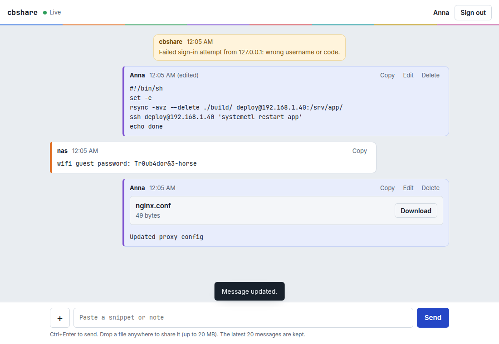

# cbshare

cbshare shares text snippets and small files between the machines on your local network. One machine runs the `cbshare` executable; everyone else opens it in a browser and sees the same group chat.

It replaces the usual workarounds, like emailing yourself a command or sending a password through a messaging app, with something that stays on your network and is encrypted end to end on the way.

## What you can do with it

- Paste a command line or script on one computer and copy it, exactly as typed, on another.
- Share a config file, a key or a small archive (up to 20 MB by default).
- Pass a Wi-Fi or service password to a colleague's machine without it leaving the LAN.

## How it works

- **One executable, no installation.** The same `cbshare` binary runs on Windows and Linux. Start it on any machine of the LAN; it becomes the server.
- **Encrypted on the wire and on disk.** Browsers connect over HTTPS. Messages and files are stored in an encrypted SQLite database that cannot be read without the key printed at first start.
- **A personal authenticator code for each user.** The admin adds each person (up to 10 by default) and gives them their own QR code. They sign in with their username and the current 6-digit code from an authenticator app. No passwords to remember.
- **A group chat.** Everyone sees the same conversation, updated live. You can edit or delete what you posted; an admin can moderate everything.
- **Short memory.** Only the latest 20 messages are kept. Older messages and their files are deleted automatically.

## Next steps

1. [Install cbshare](installation.md) on the machine that will act as the server.
2. Follow the [first-time setup](first-start.md) to create the database and the admin account, then add the other users.
3. Read [Daily use](using.md) to learn the chat.
