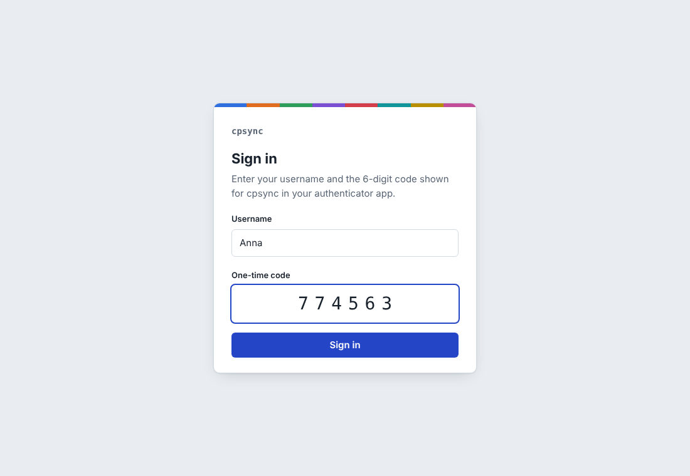
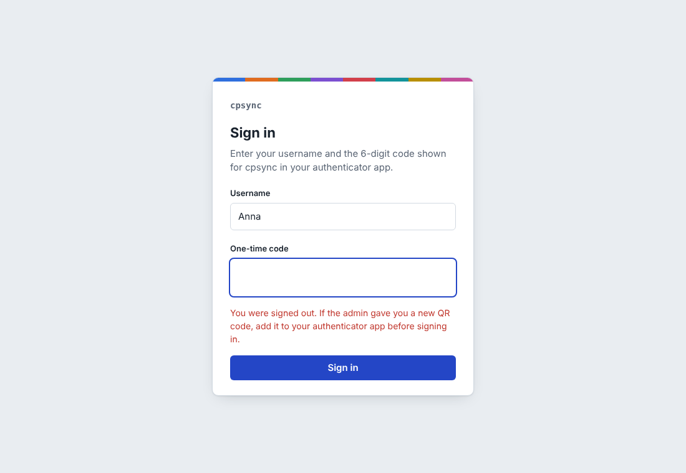
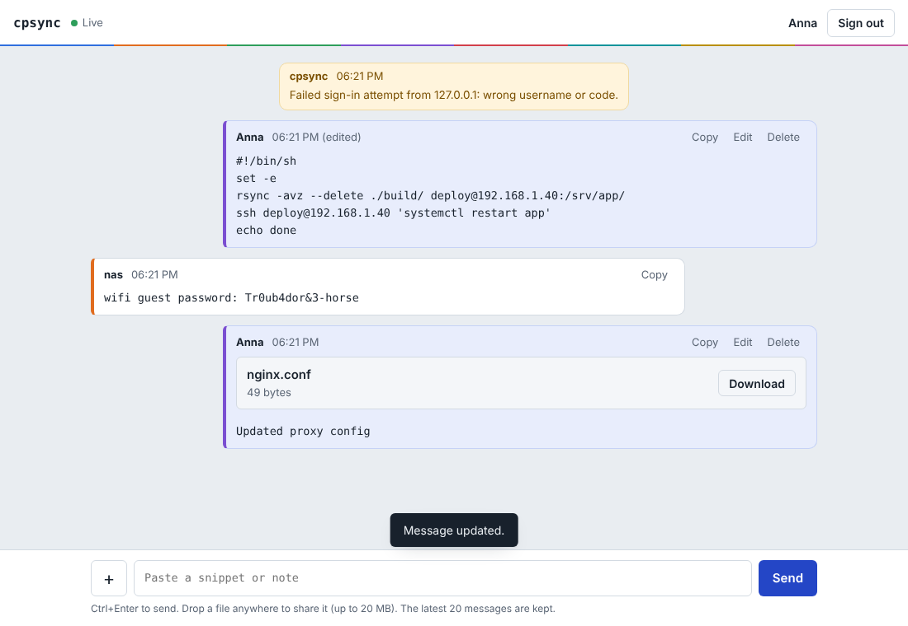
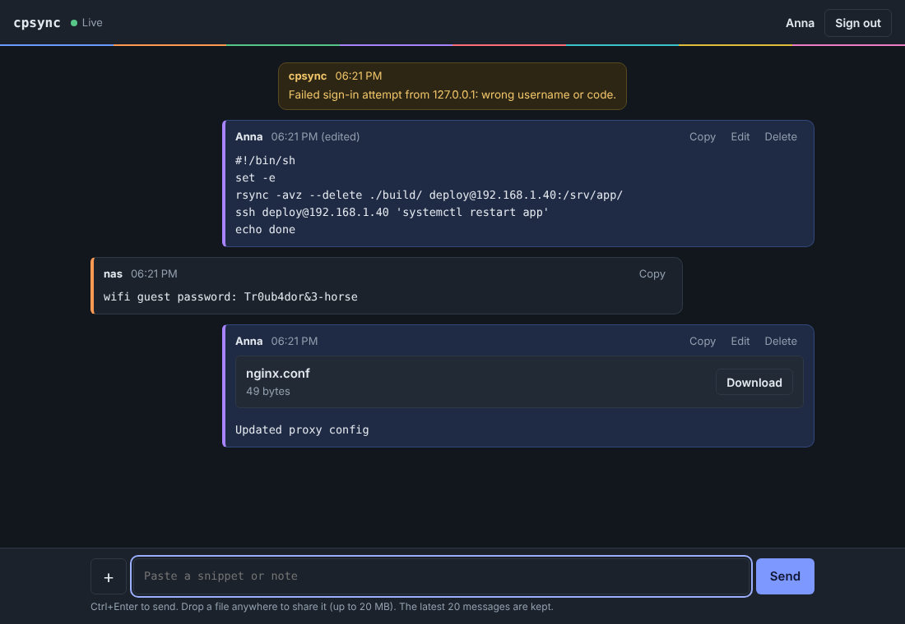
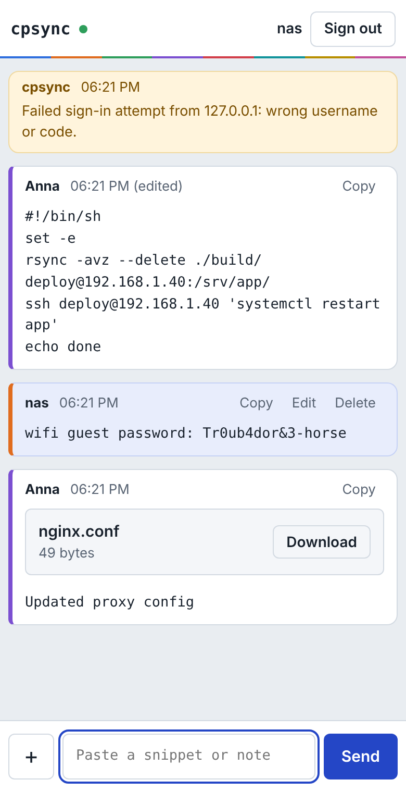

# Daily use

## Signing in

Open the cpsync address and enter your username and the current 6-digit code from your authenticator app. The admin gave you both: your account and its QR code, which you added to the app. The browser remembers your username, so next time you only type the code.

{ width="480" }

Your username appears next to your messages. Usernames don't depend on letter case: `Anna` and `anna` are the same account.

Each code works once: if you sign in twice in a row, wait for the next code.

You are signed out when you:

- choose **Sign out**;
- close the browser (sessions are not remembered);
- stay inactive for 30 minutes;
- or when the server restarts, or the admin gives you a new QR code, revokes your access or removes your account.

When that happens, the sign-in screen tells you why:

{ width="480" }

## The chat

Everyone signed in sees the same conversation. Each name gets its own colour stripe, and your own messages are on the right. System messages from cpsync, such as failed sign-in alerts or users added by the admin, appear in amber in the middle. Messages of a user the admin removed stay, marked "(deleted user)".

The indicator next to the cpsync name shows how the page stays up to date:

| Indicator | Meaning |
| --- | --- |
| **Live** (green) | New messages appear instantly. |
| **Updates every 3 s** (green) | The server uses [polling mode](configuration.md#live-updates); new messages appear within a few seconds. |
| **Reconnecting** (red) | The connection dropped; cpsync reconnects by itself. |

When the tab is in the background, its title shows how many new messages arrived, such as `(2) cpsync`.

cpsync follows your system's light or dark mode, and works on phones and tablets too.

{ width="300" }

## Sending text

Type or paste into the box at the bottom, then press **Send** or ++ctrl+enter++. ++enter++ alone adds a new line, so multi-line scripts paste and send as they are.

Text is kept exactly as typed: spacing, tabs and line breaks are preserved and shown in a monospace font. A message can be up to 256 KB; share longer text as a file.

## Copying

Every message has a **Copy** button that copies its text exactly, ready to paste in a terminal or a config file.

## Sharing files

Press **+** next to the message box and choose a file, or drag a file anywhere onto the page. If the message box contains text, it becomes the file's caption.

Files can be up to 20 MB by default. Others get a **Download** button; files are always downloaded, never opened inside cpsync.

## Editing and deleting

Messages you sent have **Edit** and **Delete** buttons.

- **Edit** opens the text in place. Press **Save** or ++ctrl+enter++; ++escape++ cancels. Edited messages are marked `(edited)`. For a file, you edit its caption.
- **Delete** asks for confirmation, then removes the message and its file for everyone.

!!! info "Who counts as the author"
    Messages belong to your account: you can edit and delete them from any machine where you are signed in, and nobody else can, except the admin. If the admin removes an account and later creates a new one with the same name, the new account does not get the old messages.

## How long messages are kept

The chat keeps the latest 20 messages, system messages included. When a new one arrives, the oldest is deleted together with its file. The number is [configurable](configuration.md).

## Failed sign-ins

Every failed attempt, whether a wrong setup PIN, username or code, or admin password, is announced in the chat with the source IP address. The alert doesn't say which username was tried. After 5 failures in a row, that address is locked out for 5 minutes. If you see alerts you can't explain, tell the admin, who can [revoke an account or give it a new QR code](administration.md#managing-users).
